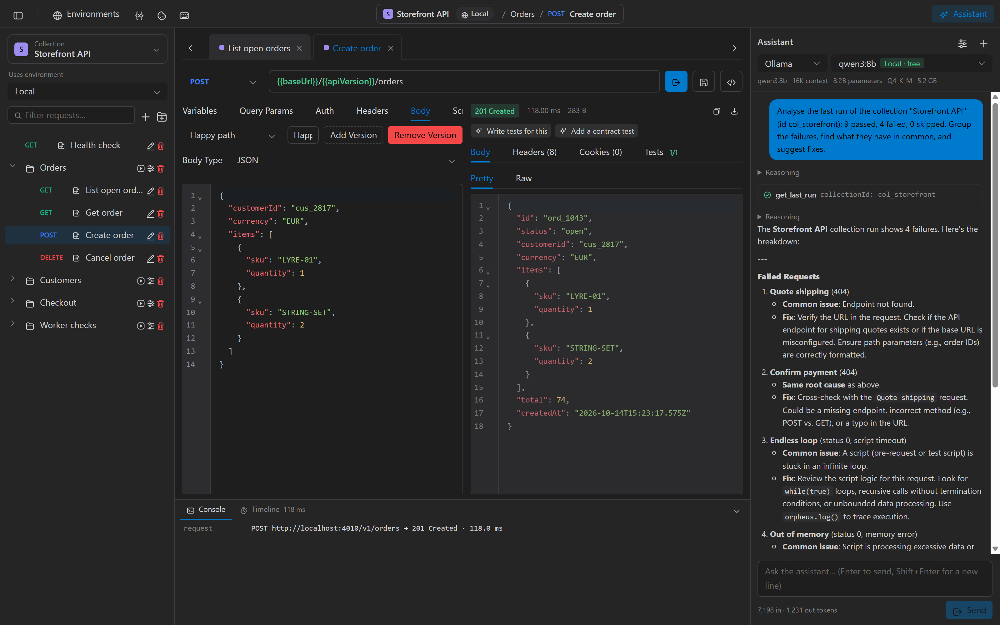

  

<h1 align="center">Orpheus API</h1>

  An API client whose assistant does the work and never sees your secrets.
   
  Free and local, for Windows, macOS and Linux.

  <a href="https://mobilotronicdevstudio.github.io/OrpheusApi/">Website</a> ·
  <a href="https://mobilotronicdevstudio.github.io/OrpheusApi/docs/getting-started/install/">Docs</a> ·
  <a href="https://github.com/MobilotronicDevStudio/OrpheusApi-App/releases">Download</a>

  

## Why Orpheus

- **An assistant that does the work.** It sends requests, runs collections, groups failures and writes tests. Every run waits for your approval, and every change arrives as a diff.
- **Secrets it can never see.** Secret variables, credentials, tokens and cookies are redacted before any model sees them, and there is no switch to turn that off. If a request it influenced would go to a host you have never used, Orpheus stops and asks.
- **Your model, or your editor's.** Use Ollama locally, or Anthropic, OpenAI or Gemini with your own key. Or turn on the local MCP endpoint and drive Orpheus from Claude Code, VS Code or Cursor under the same rules.
- **Every case on one request.** Keep named versions of a body and of its scripts, and pick which one runs.
- **Free, all of it.** No paid tier, no account and no feature held back.

## Also in the box

- Pre and post-request scripts with tests and JSON Schema checks, in a sandbox with no network or file access
- A collection runner with iterations, CSV and JSON data files, and HTML, JSON and JUnit reports
- An `orpheus` command line for CI: one executable that runs collections without the app, with exit codes, JUnit reports and secrets from CI variables
- Variables in four scopes, with secret variables and a hover that shows what will be sent
- Timing for DNS, TCP, TLS, first byte and transfer
- Basic, Bearer, API key, NTLM and OAuth 2.0 with PKCE
- Import from Postman, OpenAPI, Swagger and cURL, and export back to Postman
- Code snippets for cURL, fetch, axios, Python, C#, Go and Ruby

Orpheus is in alpha. See the [known limitations](https://mobilotronicdevstudio.github.io/OrpheusApi/docs/reference/limitations/) before you rely on it.

## Download

Get it from the [releases page](https://github.com/MobilotronicDevStudio/OrpheusApi-App/releases):

| System | File |
|---|---|
| Windows, installer | `OrpheusApi-<version>-win-x64.exe` |
| Windows, portable with no install | `OrpheusApi-<version>-win-x64-portable.exe` |
| macOS | `OrpheusApi-<version>-mac-universal.dmg` |
| Linux | `OrpheusApi-<version>-linux-x86_64.AppImage` |
| Command line | `orpheus-cli-<version>-<system>-<arch>` |

The builds are not signed yet, so your system asks you to confirm the first launch. The [install guide](https://mobilotronicdevstudio.github.io/OrpheusApi/docs/getting-started/install/) walks through it.

## Feedback

Found a bug or missing a feature? [Open an issue](https://github.com/MobilotronicDevStudio/OrpheusApi-App/issues). Please remove any secrets from logs and screenshots first.

## About this repository

This repository holds the releases and this page. The source code is not public, so pull requests can't be accepted here.

Orpheus is free to use.
